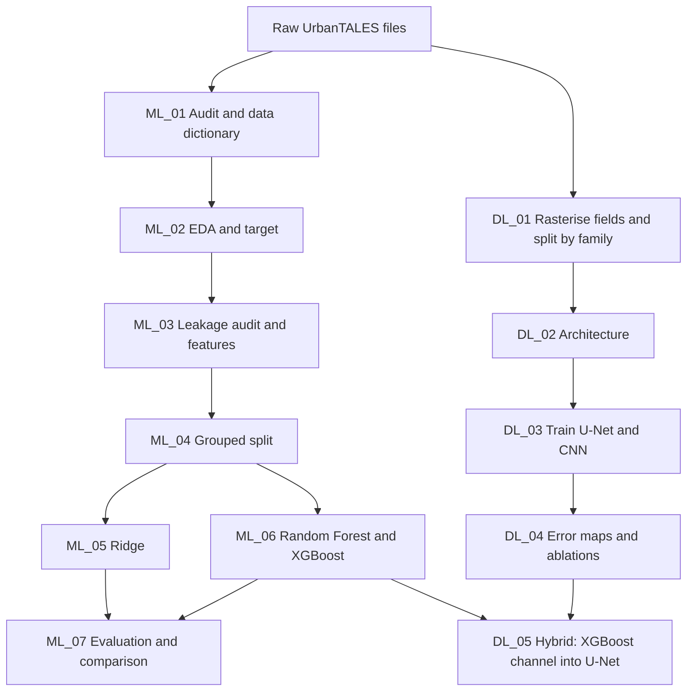
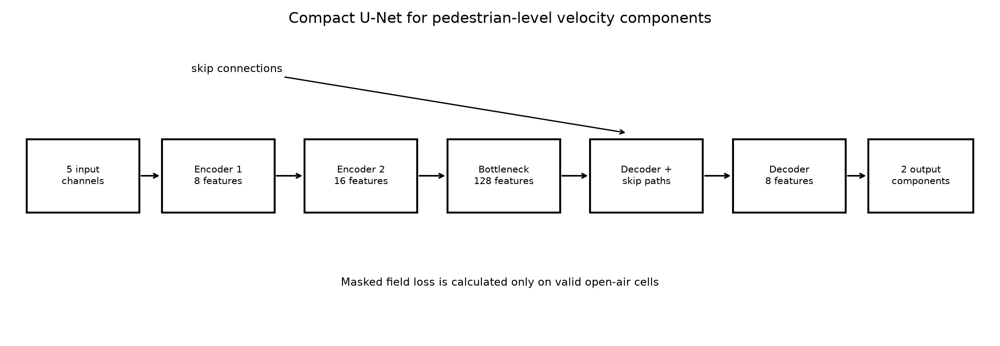
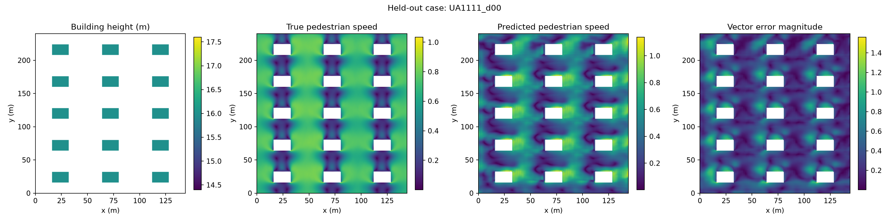
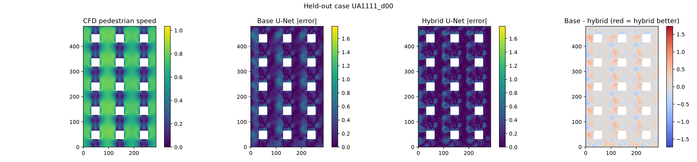

# 🌬️ T006 — Urban Microclimate Modelling
### From layout summaries to wind maps: machine-learning, deep-learning and hybrid surrogates for urban wind

<p align="center">
  
  
  
  
  
  
</p>

## 📌 Project Overview

Computational fluid dynamics (CFD) can resolve airflow around buildings, but rerunning it for every candidate layout takes hours or days. This project builds **fast, data-driven surrogates** that estimate urban wind from building layouts, and compares what each modelling approach can and cannot do.

The work ran in two phases on the same **224 idealised UrbanTALES simulations**:

| Phase | Question | Input | Output | Models |
|---|---|---|---|---|
| **Phase 1: Machine Learning** | What is the average wind speed in the street canopy? | 14 layout summary features (density, height statistics, wind direction) | **One number** per case | Mean baseline, Ridge, Random Forest, XGBoost |
| **Phase 2: Deep Learning** | Where is the air calm or fast around every building? | Layout as a 5-channel image (building heights, wind direction, friction velocity, domain mask) | **A full wind map** (u, v at 1.75 m) | Compact U-Net, simple CNN baseline |
| **Hybrid (ML + DL)** | Does the Phase 1 prediction help the U-Net? | The 5 channels plus the XGBoost canopy-mean prediction as a 6th channel | A full wind map | Hybrid U-Net with a shuffled-channel control |

> **Core principle:** Validation must test *unseen geometry*. Cases from the same plan family are never split between training and test data, in either phase.

### Results at a glance

| Phase | Headline result |
|---|---|
| **ML** | XGBoost predicts canopy-mean wind speed with **MAE 0.232 m/s and R² = 0.90** on held-out families, mostly through building density. Random Forest is statistically indistinguishable from it. |
| **DL** | A compact U-Net reproduces the main wake patterns on unseen layouts (field MAE 0.244), but a much smaller CNN scores slightly better on the three test families (0.224), so the U-Net is not a clear winner. |
| **Hybrid** | Adding the Phase 1 prediction gave **no measurable gain**. A shuffled-channel control did as well, so this is reported as a correctly implemented, controlled **negative result**. |

> Phase 1 and Phase 2 errors **cannot be compared directly**: Phase 1 error is in m/s for one value, and Phase 2 error is in stored units over a whole map.

---

## 🎯 Project Objectives

**Phase 1 (ML)**
- Audit the raw UrbanTALES files and build a traceable, case-level modelling table.
- Explore the target and geometry, and define the prediction target.
- Run a leakage audit so predictors describe the layout and wind only.
- Engineer geometry features: plan-area density, building-height statistics and circular wind-direction terms.
- Evaluate with **family-held-out cross-validation**, with layout-held-out validation as a comparison.
- Quantify uncertainty with family-level bootstrap intervals and a paired model comparison.

**Phase 2 (DL)**
- Rasterise the full 224-case dataset into leakage-safe image tensors with a valid-air mask.
- Train a compact U-Net (and a simple CNN baseline) to predict the pedestrian-level velocity field.
- Evaluate on unseen families with field error metrics, error maps and input ablations.
- Test a hybrid ML + DL model with a proper control, and report the result honestly.

---

## 🧠 Problem Statement

**Phase 1.** Given layout-level geometric summaries and the wind direction, predict the canopy-averaged wind speed. The target, `target_U_canopy_mean_m_s`, comes from the raw `U` column in `data/raw/UrbanTALES-flowdata.csv` and is defined by the UrbanTALES datasheet as averaged from ground level to mean building height.

**Phase 2.** Given a building-height map, wind direction and friction velocity, predict the pedestrian-level velocity components (`uped`, `vped`) at every air cell. Building cells are masked out of the loss and the metrics.

Both are **regression problems**. The dataset has no temperature output, so the project models **wind only**.

---

## 📂 Dataset

**Source:** UrbanTALES idealised building arrays (Nazarian et al., 2025).

| Attribute | Value |
|---|---|
| Simulation cases | 224 (one per layout × wind direction) |
| Unique layouts | 112 |
| Plan families | 16 (an arrangement type × one of 8 density levels, 0.0625 to 0.64) |
| Wind directions | 0° and 45° |
| Mean building height | 16 m in every case |
| Phase 1 target | `target_U_canopy_mean_m_s`, range 0.90–5.22 m/s (mean 2.05, median 1.60, SD 1.00, right-skewed) |
| Phase 2 target | `uped`, `vped` at 1.75 m, on grids from 120×200 to 384×768 cells (0.5 m spacing) |
| Missing values | None in the Phase 1 modelling table |

### What each phase uses

| | Phase 1 (ML) | Phase 2 (DL) |
|---|---|---|
| What one case is | One row of a table | One 2D wind map plus a building map |
| Files used | Building-height metadata and the flow-data table; sample ZIPs for checks only | 224 pedestrian NetCDF + 224 topography files from the full UrbanTALES package |
| Size | 224 rows | 5,184 to 257,472 air cells per case; about 15.2 million in total |
| Why this much data | One number per case needs only a summary table | A map needs the position of every building and the wind at every cell |

The full package also holds 224 time-series NetCDF files and 224 vertical-profile CSV files per type. These were checked but **not used**. The NetCDF velocity variables carry no unit attribute, so **field errors are reported in stored units, not m/s**.

### What the EDA found (Phase 1)

- Sparse layouts average **3.04 m/s**; medium **1.60**; dense **1.37**.
- Mean wind speed is **2.24 m/s at 0°** and **1.86 m/s at 45°**. Across the 112 layouts, the mean 45°−0° change is −0.375 m/s.
- Plan-area density has the strongest raw linear association with the target (Pearson r = −0.75).
- Family means span 1.18–4.23 m/s, which is why random row splits would be misleading.

### Data storage

- `data/raw/` holds the supplied raw data and three sample ZIP archives (32 members each, not all 224 cases).
- `data/processed/` holds the ML_01 outputs. Re-running ML_01 regenerates them.
- `dl_results/processed_fields/` holds the 224 prepared field files (`.npz`) written by DL_01, plus manifests and normalisation statistics.
- Profile-integrated mean wind speed matches the flow-table target with a mean absolute difference of 0.047 m/s, which supports the target definition.

---

## ⚙️ Project Workflow



---

# Phase 1: Machine Learning

### Notebook guide

Run all cells in the notebooks under `Machine Learning Pipeline/` in numerical order. **Run ML_01 first:** later notebooks use the processed dataset it produces.

| Notebook | Stage | What it does |
|---|---|---|
| ML_00 | Problem framing | Literature review and problem definition |
| ML_01 | Dataset understanding | Reads raw metadata and the flow table, audits the ZIP archives, validates case/layout/family counts, builds the processed dataset |
| ML_02 | EDA and target definition | Descriptive statistics, target and predictor distributions, direction effects, family-level variation |
| ML_03 | Leakage audit and features | Builds the modelling table, checks the predictor whitelist, examines feature relationships |
| ML_04 | Grouped split and preprocessing | Constructs family-held-out folds and demonstrates leakage-safe preprocessing |
| ML_05 | Ridge regression | Trains the linear baseline; out-of-fold predictions and metrics |
| ML_06 | Random Forest and XGBoost | Trains the tree models; metrics and feature importance |
| ML_07 | Evaluation and comparison | Compares models across validation protocols, plus the feature ablation, bootstrap intervals and diagnostic plots |

### Leakage prevention

Predictors describe the layout and wind conditions only. The following are **excluded**:

| Excluded | Reason |
|---|---|
| Target values | They define what is being predicted |
| Simulation, layout and family IDs | Identifiers that would let a model memorise groups |
| Raw wind direction (degrees) | Replaced by its sine and cosine |
| Original catalogue CL/SM label | Kept for traceability only; its physical meaning differs from the folder-code convention and is not verified |

### Features

| Group | Features |
|---|---|
| Plan geometry | Plan-area density and its square |
| Building heights | Standard deviation, min, max, range, skew, coefficient of variation, fraction taller than the mean |
| Wind and layout type | Wind-direction sine and cosine, horizontal configuration (aligned/staggered), height-pattern `configuration` (uniform/CL/HR/SM), density class |

In total there are 14 predictors (11 numeric, 3 categorical), defined by the whitelist in ML_03. A 9-predictor baseline set (which adds `building_count`) is used only for the feature ablation. With only 0° and 45° in the data, the sine/cosine pair behaves as a two-state flag, so no claim is made about other angles.

### Evaluation strategy

Closely related layouts can make random row splits look more optimistic than real generalisation. Three protocols are compared:

| Protocol | Method | Role |
|---|---|---|
| `family_5fold` | GroupKFold by `family_id` (folds of 4/3/3/3/3 families) | **Primary** |
| `family_loo` | Leave one of the 16 families out in turn | Stricter secondary check |
| `layout_5fold` | GroupKFold by `layout_id` | Interpolation-style comparison; related families may be shared across train and test |

Preprocessing is fitted on training folds only, and train/test overlap of families and layouts is checked.

| Model | Role |
|---|---|
| Mean baseline | No-feature reference (training-fold mean) |
| Ridge regression | Transparent linear baseline, standardised inputs, L2 penalty |
| Random Forest | Nonlinear benchmark (300 trees) |
| XGBoost | Boosting challenger (200 trees, depth 2, learning rate 0.03, subsample 0.85, column sample 0.9) |

All models use fixed settings; there is no nested hyperparameter optimisation. Metrics are MAE (m/s, primary), RMSE (m/s), normalised RMSE (RMSE ÷ target range) and R² against a constant-mean reference (can be negative).

### Phase 1 results

Pooled out-of-fold results from **ML_07** (224 cases, 16 families, engineered features).

**Primary: `family_5fold`**

| Model | MAE (m/s) | RMSE (m/s) | Norm. RMSE | R² |
|---|---:|---:|---:|---:|
| **XGBoost** | **0.232** | **0.309** | **0.071** | **0.903** |
| Random Forest | 0.256 | 0.380 | 0.088 | 0.854 |
| Ridge regression | 0.400 | 0.507 | 0.117 | 0.740 |
| Mean baseline | 0.798 | 1.011 | 0.234 | −0.033 |

XGBoost reduces MAE by 0.565 m/s (70.9%) relative to the mean baseline, about 11% of the mean target value.

**MAE across validation protocols**

| Model | family_5fold | family_loo | layout_5fold |
|---|---:|---:|---:|
| XGBoost | 0.232 | 0.238 | 0.150 |
| Random Forest | 0.256 | 0.250 | 0.065 |
| Ridge regression | 0.400 | 0.403 | 0.332 |
| Mean baseline | 0.798 | 0.836 | 0.790 |

Holding out sibling layouts instead of whole families makes Random Forest look about four times better (0.065 vs 0.256 m/s). Treat `layout_5fold` as an interpolation check, not as the generalisation claim; `family_loo` agrees with `family_5fold`.

**Robustness**

| Check | Result |
|---|---|
| 95% family-bootstrap CI for MAE | XGBoost 0.18–0.29; Random Forest 0.18–0.34; Ridge 0.31–0.50; Mean baseline 0.57–1.08 |
| Paired Random Forest vs XGBoost | MAE difference +0.024 m/s (RF minus XGBoost), 95% CI −0.016 to +0.069. The interval spans zero, so there is no reliable winner between the two tree models |
| Feature ablation (engineered vs baseline features) | Ridge improves by 0.039 m/s; Random Forest worsens by 0.017; XGBoost is unchanged (0.000) |
| Ridge α sensitivity (pooled MAE) | 0.01: 0.402; 0.1: 0.401; 1: 0.400; 10: 0.427; 100: 0.473 |

**Feature importance (descriptive).** Plan-area density and its square account for about 73% of importance in both tree models (Random Forest 0.345 + 0.389; XGBoost 0.413 + 0.321). Random Forest also assigns 0.11 to density class and about 0.05 each to wind-direction sine and cosine; XGBoost assigns 0.08 to horizontal configuration and 0.06–0.07 to the wind-direction terms. Importance is descriptive, not causal.

**Error diagnostics.** Errors are largest for the fast, sparse cases (observed speeds above about 4 m/s) and larger at 0° than at 45°, where the target varies less (SD 1.19 vs 0.72 m/s).

**What Phase 1 cannot do:** a handful of summary numbers cannot describe wakes or street-canyon effects. That limitation motivates Phase 2.

---

# Phase 2: Deep Learning

Phase 1 can say "the average wind speed in this canopy is about 1.6 m/s". Phase 2 shows **where** the air is calm or fast around every building, so local patterns such as the sheltered wake behind a block can be learned instead of averaged away.

### Notebook guide

Run the notebooks under `Deep Learning Pipeline/` in numerical order. They import shared code from the `dl_src/` module.

| Notebook | Stage | What it does |
|---|---|---|
| DL_01 | Dataset audit and preparation | Matches all 224 cases across the file types, reads the pedestrian velocities and building height maps, rotates them to image orientation, builds the valid-air mask, computes train-only normalisation statistics and writes the family-held-out split |
| DL_02 | Literature review and architecture | Justifies and defines the compact U-Net and the CNN baseline |
| DL_03 | Training and regularisation | Trains both models with early stopping; learning curves |
| DL_04 | Technical validation and ablations | Scores all models once on the held-out test families; error maps; input ablations |
| DL_05 | Hybrid ML + DL integration | Feeds the Phase 1 XGBoost prediction into the U-Net as an extra channel, with a shuffled-channel control |

### Data preparation (DL_01)

- Velocity components `uped`, `vped` and the building height map are read for each of the 224 cases.
- A **valid-air mask** marks a cell as usable only if it is not a building and both velocities are finite.
- **No resampling:** the original 0.5 m grid is kept.
- Normalisation statistics (mean and standard deviation of u and v, a building-height scale of 37 m, and friction velocity) are computed on **training cases only** (7.68 million air cells), so nothing leaks from validation or test.

### Model

| | Compact U-Net (primary) | Compact CNN (baseline) |
|---|---|---|
| Inputs (5 channels) | Building height, sin and cos of wind direction, friction velocity, domain mask | Same |
| Outputs (2 channels) | `uped`, `vped` | Same |
| Design | Encoder–decoder with skip connections, GroupNorm, GELU, a dropout layer in the middle | Small CNN, no skip connections |
| Parameters | 486,706 | 32,570 |
| Loss | Masked mean squared error (building cells never count) | Same |

The design follows Thuerey et al. (2020): geometry plus constant condition channels, evaluated on unseen geometries, with no built-in physics.

<p align="center">
  
</p>

### Training and split

- **Family-held-out split:** 10 families for training (140 cases), 3 for validation (42 cases: S1111, S25, S64) and 3 for testing (42 cases: A0625, A1111, A4444). The test set includes the **sparsest family in the dataset** (A0625, density 0.0625), where flow is fastest and hardest to extrapolate, so this is a demanding test.
- Batch size 1, AdamW (learning rate 1e-3, weight decay 1e-4), gradient clipping at 1.0, seed 42, trained on Apple Silicon (MPS).
- Regularisation: dropout, weight decay, gradient clipping and early stopping (patience 7 for the U-Net, 5 for the CNN). The U-Net ran all 25 epochs; the CNN stopped at epoch 13.
- As is typical for small data, training loss keeps falling while validation loss flattens.

### Phase 2 results

All models were scored once on the three untouched test families, over **5.16 million valid air cells**. Errors are in **stored units**, not m/s.

**Test results on held-out families**

| Model | Field MAE | Field RMSE | Norm. RMSE | Epochs |
|---|---:|---:|---:|---:|
| U-Net (5 channels) | 0.2438 | 0.3416 | 0.107 | 25 |
| Compact CNN | **0.2238** | **0.2839** | **0.089** | 13 (early stop) |
| Ablation: geometry only (channels 0, 4) | 0.2815 | 0.3716 | 0.117 | 10 |
| Ablation: without friction velocity | 0.2623 | 0.3576 | 0.112 | 10 |

**Error depends strongly on the family** (mean field MAE per test family):

| Test family | Plan-area density (from family code) | U-Net | CNN |
|---|---|---:|---:|
| A0625 | 0.0625 (sparsest in the dataset) | 0.300 | **0.242** |
| A1111 | 0.1111 | **0.161** | 0.204 |
| A4444 | 0.4444 | **0.081** | 0.116 |

The U-Net beats the CNN on two of the three families. The CNN's overall lead comes from the sparsest family, where flow is fastest and hardest to extrapolate. With only three test families, **neither model can be called the winner**.

**What the U-Net gets right and wrong.** It reproduces the main pattern: slow, sheltered air behind each block and faster flow in the gaps beside it. Its picture is streakier than the truth, and errors concentrate in the streets right around buildings, where the wind changes quickly.

<p align="center">
  
</p>

**Two honest points.** First, the simple CNN scored better than the U-Net overall although the U-Net was better on validation. Second, the ablations used 10 epochs against 25 for the full model, so their gaps show direction (more input channels helped) but not an exact size.

### Hybrid ML + DL experiment (DL_05)

Following the project brief, the U-Net receives the XGBoost-predicted canopy-mean speed as a constant **6th input channel**, hoping the global hint helps a network that only sees local windows.

To stay leak-free:
- Each **training** case's value comes from XGBoost models that never saw its family (out-of-fold).
- **Validation and test** values come from the average of those fold models.
- XGBoost runs in its own process, the channel is scaled with the true training target, and every run has a fixed seed.
- A **shuffled-channel control** feeds the same values to the wrong cases. If the real channel is useful, it must beat the control.

| Model (seed 42, test families) | Field MAE | Field RMSE | Change vs base |
|---|---:|---:|---:|
| Base U-Net | 0.2438 | 0.3416 | reference |
| Hybrid (real XGBoost channel) | 0.2527 | 0.3517 | 3.6% worse |
| Shuffled-channel control | 0.2386 | 0.3426 | 2.1% better |

**Result:** the hybrid did not improve the surrogate. It beat the base U-Net on only **16 of 42** test cases (0 of 14 in A0625, 10 of 14 in A1111, 6 of 14 in A4444) and was worse on the sparsest family, where XGBoost itself must extrapolate (test R² = 0.74 and MAE 0.435 m/s, against 0.90 in Phase 1 cross-validation). Because the shuffled control did as well as the real channel, differences of a few percent are within ordinary run-to-run variation. This is reported as a correctly implemented, controlled **negative result**.

<p align="center">
  
</p>

---

## 🛠️ Technology Stack

| Technology | Purpose |
|---|---|
| Python 3.10+ (3.11/3.12 recommended) | Core language |
| Pandas / NumPy / SciPy | Data handling and feature engineering |
| Matplotlib | Plots and error maps |
| scikit-learn | Ridge, Random Forest, grouped cross-validation, metrics |
| XGBoost | Gradient-boosted trees (Phase 1 model and hybrid channel) |
| PyTorch | U-Net and CNN (Phase 2) |
| h5py | Reading NetCDF/HDF5 velocity files |
| Jupyter | Notebook-first workflow |

Exact dependencies are in `requirements.txt` (ML) and `requirements-dl.txt` (DL, adds PyTorch).

---

## 📁 Repository Structure

```text
T006-urban-microclimate-modelling/
│
├── README.md
├── requirements.txt              # Phase 1 (ML) dependencies
├── requirements-dl.txt           # Phase 2 (DL) dependencies, adds PyTorch
│
├── Machine Learning Pipeline/    # ML_00 – ML_07 notebooks
├── Deep Learning Pipeline/       # DL_01 – DL_05 notebooks
├── dl_src/                       # Shared DL code: data, models, training, metrics, hybrid channel
│
├── data/
│   ├── raw/                      # Supplied raw data + three sample ZIP archives
│   └── processed/                # Regenerated by ML_01
│
├── results/                      # Phase 1 tables: metrics, predictions, feature importance, bootstrap CIs
├── dl_results/                   # Phase 2 outputs
│   ├── figures/                  # Learning curves, architecture, error maps, hybrid comparison
│   ├── processed_fields/         # 224 prepared field files (.npz)
│   ├── models/                   # Trained weights (.pt) and XGBoost channel models
│   └── predictions/              # Saved per-model predictions
│
├── docs/                         # Data dictionary, extraction notes, methodology
├── Report/                       # Report_AML.pdf (Phase 1), Report_DL.pdf (Phase 1 + 2)
└── Presentation/                 # Presentation_AML.pdf
```

---

## 🚀 Getting Started

```bash
git clone https://github.com/aarya-sr/T006-urban-microclimate-modelling.git
cd T006-urban-microclimate-modelling

python -m venv .venv
source .venv/bin/activate        # macOS/Linux
python -m pip install --upgrade pip
pip install -r requirements-dl.txt   # use requirements.txt for the ML phase only
jupyter lab
```

**Phase 1 (ML)**
1. Open `Machine Learning Pipeline/ML_01_dataset_understanding_data_dictionary.ipynb`, select the environment's kernel and run all cells.
2. Run ML_02 to ML_07 in numerical order.
3. Find the evaluation tables in `results/`.

**Phase 2 (DL)**
1. Run the notebooks in `Deep Learning Pipeline/` in numerical order, DL_01 to DL_05.
2. **DL_01 needs the full UrbanTALES Phase 2 package** (the complete pedestrian NetCDF and topography files). Place the ZIP in `data/raw/`; the sample ZIPs that ship with the repo hold only 32 members each and are not enough.
3. The prepared fields, split manifest and normalisation statistics that DL_01 writes are already committed in `dl_results/`, so you can start from them without the large download.
4. The reported runs used Apple Silicon (MPS) with seed 42. Training the U-Net on other hardware may take longer.

---

## 📄 Report and Presentation

| Document | Contents |
|---|---|
| [`Report/Report_DL.pdf`](Report/Report_DL.pdf) | Full IEEE-style report covering Phase 1 (ML), Phase 2 (DL) and the hybrid experiment |
| [`Report/Report_AML.pdf`](Report/Report_AML.pdf) | Phase 1 (Machine Learning evaluation) project report |
| [`Presentation/Presentation_AML.pdf`](Presentation/Presentation_AML.pdf) | Phase 1 presentation (14 slides) |

---

## 👥 Team Contributions

| Notebook | Team member | Responsibility |
|---|---|---|
| ML_01 | Suhaani Garg | Dataset understanding and data dictionary |
| ML_02 | Aarya Srivastava | EDA and target definition |
| ML_03 | Jashvitha Lakshmi Omkaram | Leakage audit and feature engineering |
| ML_04 | Jashvitha Lakshmi Omkaram | Grouped split and preprocessing |
| ML_05 | Palak | Ridge regression |
| ML_06 | Samarth Sangtani | Random Forest and XGBoost |
| ML_07 | Suhaani Garg | Evaluation, comparison and diagnostics |
| DL_01 | Suhaani Garg | Dataset audit and data preparation |
| DL_02 | Aarya Srivastava | Literature review and architecture |
| DL_03 | Palak | Training and regularisation |
| DL_04 | Jashvitha Lakshmi Omkaram | Technical validation, error maps and ablations |
| DL_05 | Samarth Sangtani | Hybrid ML + DL integration |

Everyone contributed to the literature review and the report.

---

## ⚠️ Limitations and Considerations

**Data and scope**
- **Idealised cases:** regular block arrays with two wind directions (0° and 45°) and a constant 16 m mean building height. Results do not transfer to real cities and are not a substitute for safety-critical design approval or for CFD.
- **Small sample:** 224 cases, 112 layouts and only 16 plan families.
- **Wind only:** the dataset does not support temperature or heat prediction.
- **Catalogue labels:** the CL/SM configuration labels differ from the folder-code convention. Verify them against the UrbanTALES documentation before making claims about them.

**Phase 1 (ML)**
- **Scalar output only:** no local wakes, street-canyon detail or spatial velocity maps.
- **Fixed settings:** no nested hyperparameter optimisation, so rankings may change with tuning. Random Forest and XGBoost are not statistically separable here.
- Feature importance and correlation are not causal evidence.

**Phase 2 (DL)**
- **Only three test families:** they include the sparsest layouts, which makes the test demanding, but the set is too small to rank the U-Net against the CNN.
- **Single seed:** all DL results use seed 42, so run-to-run variation is not measured.
- **Unequal ablation budget:** ablations trained for 10 epochs against 25 for the full model, so their gaps show direction, not exact size.
- **No physics built in:** the model learns patterns from data and can be wrong near buildings, where the wind changes quickly.
- **Stored units:** the velocity files carry no unit attribute, so field errors are not reported in m/s.
- **Hybrid:** one seed only. The negative result needs more seeds to confirm.

---

## 🔮 Future Improvements

- Repeat the DL runs with seeds 42, 43 and 44 and report the spread.
- Retrain the ablations with the same budget as the full model.
- Cross-validate the deep models over families instead of using a single split of three test families.
- Try a stronger conditioning method than a constant channel for the hybrid.
- Add more wind directions and building-height variation.
- Add nested hyperparameter search for the Phase 1 models and re-test the ranking.

---

## 📚 Key References

1. N. Nazarian et al., "UrbanTALES: A Large-Eddy Simulation Dataset for Urban Canopy Layer Turbulence and Parameterization," *Bull. Amer. Meteorol. Soc.*, 106(12), E2461–E2478, 2025.
2. O. Ronneberger, P. Fischer and T. Brox, "U-Net: Convolutional networks for biomedical image segmentation," *MICCAI*, 2015.
3. N. Thuerey et al., "Deep learning methods for Reynolds-averaged Navier–Stokes simulations of airfoil flows," *AIAA J.*, 58(1), 25–36, 2020.
4. D. R. Roberts et al., "Cross-validation strategies for data with temporal, spatial, hierarchical, or phylogenetic structure," *Ecography*, 40(8), 913–929, 2017.
5. T. Chen and C. Guestrin, "XGBoost: A scalable tree boosting system," *ACM SIGKDD*, 2016.
6. S. L. Brunton, B. R. Noack and P. Koumoutsakos, "Machine learning for fluid mechanics," *Annu. Rev. Fluid Mech.*, 52, 477–508, 2020.
7. A. B. Farimani, J. Gomes and V. S. Pande, "Deep learning the physics of transport phenomena," arXiv:1709.02432, 2017.

---

## 📜 Data Attribution and Licence

The supplied extraction notes state that UrbanTALES data is provided under **CC BY-NC 4.0**. Retain attribution and verify the original dataset terms before redistribution or commercial use. The dataset licence does not automatically determine the licence for the project code.

---

## 📌 Project Status

**Project:** T006 — Urban Microclimate Modelling
**Phase 1 (ML):** complete: tabular baseline with grouped validation
**Phase 2 (DL):** complete: U-Net and CNN field surrogates, ablations and a controlled hybrid experiment (negative result)

<p align="center">
  <b>T006 — Urban Microclimate Modelling</b><br>
  From CFD cases to fast surrogates, tested honestly on unseen geometry.
</p>
