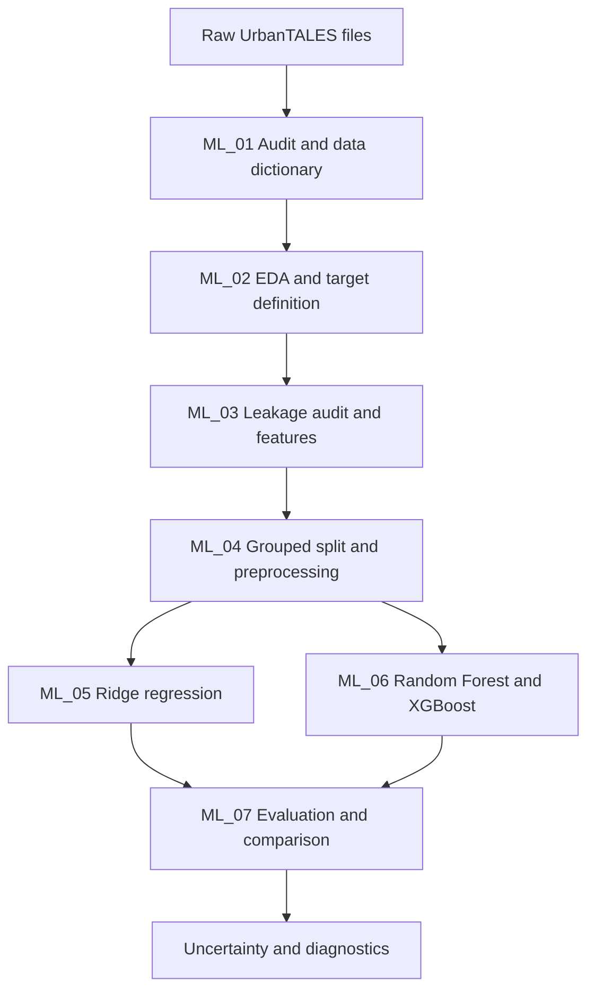

# 🌬️ T006 — Urban Microclimate Modelling
### Predicting canopy-averaged wind speed from idealised building layouts, as a first step towards neural CFD surrogates

<p align="center">
  
  
  
  
  
</p>

## Project Overview

Computational fluid dynamics (CFD) can resolve airflow around buildings, but rerunning it for every candidate layout is expensive. This project asks whether a **fast, data-driven surrogate** can predict the average wind speed inside an urban canopy from simple geometric summaries of the layout and the wind direction.

**Phase 1 (this repository)** is an executable machine-learning baseline. It uses the **224 idealised UrbanTALES cases** and predicts **one scalar per case**: the canopy-averaged wind speed. It does *not* predict local wakes, street-canyon patterns, a full velocity field or temperature.

**Phase 2 (proposed, not implemented)** would move from a scalar to a spatial field, using a rasterised layout plus conditions as input to a compact U-Net or conditional CNN.

> **Core principle:** Validation must test *unseen geometry*. Cases from the same plan family are never split between training and test data in the primary evaluation.

---

## Project Objectives

- Audit the raw UrbanTALES files and build a traceable, case-level modelling table.
- Explore the target and geometry, and define the Phase 1 prediction target.
- Run a leakage audit so that predictors describe the layout and wind only.
- Engineer geometry features: plan-area density, building-height statistics and circular wind-direction terms.
- Evaluate with **family-held-out cross-validation**, with layout-held-out validation as a comparison.
- Compare a mean baseline, Ridge regression, Random Forest and XGBoost.
- Quantify uncertainty with family-level bootstrap intervals and a paired model comparison.
- State clearly what a scalar surrogate can and cannot claim.

---

## Problem Statement

Given layout-level geometric summaries and the wind direction, predict the canopy-averaged wind speed for a simulated case.

This is a **regression problem**. The target, `target_U_canopy_mean_m_s`, comes from the raw `U` column in `data/raw/UrbanTALES-flowdata.csv`. The UrbanTALES datasheet describes the flow-data variables as canopy-averaged from ground level to mean building height, and defines `U` as wind speed in m/s.

---

## Dataset

**Source:** UrbanTALES idealised building arrays (supplied raw files in `data/raw/`).

| Attribute | Value |
|---|---|
| Simulation cases | 224 (one per layout × wind direction) |
| Unique layouts | 112 |
| Plan families | 16 (7 layouts each) |
| Wind directions | 0° and 45° |
| Mean building height | 16 m in every case |
| Target | `target_U_canopy_mean_m_s` (m/s) |
| Target range | 0.90–5.22 m/s (mean 2.05, median 1.60, SD 1.00, right-skewed) |
| Missing values | None in the modelling table |

### What the EDA found

- Sparse layouts average **3.04 m/s**; medium **1.60**; dense **1.37**.
- Mean wind speed is **2.24 m/s at 0°** and **1.86 m/s at 45°**. Across the 112 layouts, the mean 45°−0° change is −0.375 m/s.
- Plan-area density has the strongest raw linear association with the target (Pearson r = −0.75).
- Family means span 1.18–4.23 m/s, which is why random row splits would be misleading.

### Data storage

- `data/raw/` holds the supplied raw data and three sample ZIP archives.
- `data/processed/` holds the ML_01 outputs: the processed dataset, data dictionary, dataset summary and raw-archive audit tables. Re-running ML_01 regenerates them from the raw inputs.
- Each ZIP archive contains **32 sample members, not all 224 cases**. The profile archive is used for a diagnostic comparison against the flow-table target; the topology and NetCDF archives are inventoried only. They are not treated as complete spatial-field data.

---

## Project Workflow



### Notebook guide

Run all cells in the seven notebooks under `Machine Learning Pipeline/`, in numerical order. **Run ML_01 first:** later notebooks use the processed dataset it produces.

| Notebook | Stage | What it does |
|---|---|---|
| ML_01 | Dataset understanding | Reads raw metadata and the flow table, audits all three ZIP archives, validates case/layout/family counts, builds the processed dataset |
| ML_02 | EDA and target definition | Descriptive statistics, target and predictor distributions, direction effects, family-level variation |
| ML_03 | Leakage audit and features | Builds the modelling table, checks the predictor whitelist, examines feature relationships |
| ML_04 | Grouped split and preprocessing | Constructs family-held-out folds and demonstrates leakage-safe preprocessing |
| ML_05 | Ridge regression | Trains the linear baseline; out-of-fold predictions and metrics |
| ML_06 | Random Forest and XGBoost | Trains the tree models; metrics and feature importance |
| ML_07 | Evaluation and comparison | Compares models across validation protocols, plus the feature ablation, bootstrap intervals and diagnostic plots |

No precomputed metrics or predictions are supplied as inputs to any model notebook.

### Leakage prevention

Predictors describe the layout and wind conditions only. The following are **excluded**:

| Excluded | Reason |
|---|---|
| Target values | They define what is being predicted |
| Simulation, layout and family IDs | Identifiers that would let a model memorise groups |
| Raw wind direction (degrees) | Replaced by its sine and cosine |
| Original catalogue CL/SM label | Kept for traceability only; its physical meaning differs from the folder-code convention and is not verified |

### Features

| Group | Features |
|---|---|
| Plan geometry | Plan-area density and its square |
| Building heights | Standard deviation, min, max, range, skew, coefficient of variation, fraction taller than the mean |
| Wind and layout type | Wind-direction sine and cosine, horizontal configuration (aligned/staggered), density class |

The exact predictor whitelist is defined in ML_03. With only 0° and 45° in the data, the sine/cosine pair behaves as a two-state flag, so no claim is made about other angles.

---

## Evaluation Strategy

Closely related layouts can make random row splits look more optimistic than real generalisation. Three protocols are compared:

| Protocol | Method | Role |
|---|---|---|
| `family_5fold` | GroupKFold by `family_id` (folds of 4/3/3/3/3 families) | **Primary** |
| `family_loo` | Leave one of the 16 families out in turn | Stricter secondary check |
| `layout_5fold` | GroupKFold by `layout_id` | Interpolation-style comparison; related families may be shared across train and test |

Preprocessing is fitted on training folds only, and train/test overlap of families and layouts is checked.

### Models

| Model | Role |
|---|---|
| Mean baseline | No-feature reference (training-fold mean) |
| Ridge regression | Transparent linear baseline, standardised inputs, L2 penalty |
| Random Forest | Nonlinear benchmark |
| XGBoost | Boosting challenger |

All models use fixed settings; there is no nested hyperparameter optimisation.

### Metrics

MAE (m/s, primary), RMSE (m/s), normalised RMSE (RMSE ÷ target range) and R² against a constant-mean reference (can be negative).

---

## Results

Pooled out-of-fold results from **ML_07** (224 cases, 16 families, engineered features).

### Primary: `family_5fold`

| Model | MAE (m/s) | RMSE (m/s) | Norm. RMSE | R² |
|---|---:|---:|---:|---:|
| **Random Forest** | **0.259** | **0.384** | **0.089** | **0.851** |
| XGBoost | 0.298 | 0.401 | 0.093 | 0.838 |
| Ridge regression | 0.400 | 0.507 | 0.117 | 0.740 |
| Mean baseline | 0.798 | 1.011 | 0.234 | −0.033 |

Random Forest reduces MAE by 0.538 m/s (67.5%) relative to the mean baseline, about 13% of the mean target value.

### MAE across validation protocols

| Model | family_5fold | family_loo | layout_5fold |
|---|---:|---:|---:|
| Random Forest | 0.259 | 0.252 | 0.068 |
| XGBoost | 0.298 | 0.307 | 0.217 |
| Ridge regression | 0.400 | 0.403 | 0.332 |
| Mean baseline | 0.798 | 0.836 | 0.790 |

Holding out sibling layouts instead of whole families makes Random Forest look about four times better. Treat `layout_5fold` as an interpolation check, not as the generalisation claim.

### Robustness

| Check | Result |
|---|---|
| 95% family-bootstrap CI for MAE | Random Forest 0.18–0.34; XGBoost 0.24–0.36; Ridge 0.31–0.50; Mean baseline 0.57–1.08 |
| Paired Random Forest vs XGBoost | MAE difference −0.039 m/s, 95% CI −0.083 to +0.011. The interval spans zero, so there is no reliable winner between the two tree models |
| Feature ablation (engineered vs baseline features) | Ridge improves by 0.039 m/s; Random Forest worsens by 0.018; XGBoost worsens by 0.002 |

### Feature importance (ML_06, descriptive)

Plan-area density and its square account for about 73% of Random Forest importance (0.345 + 0.389). Wind direction (sin + cos) adds about 0.09, density class 0.04 and horizontal configuration 0.02. Importance is descriptive, not causal.

> **Reproducing the numbers:** `results/` is generated by the notebooks and is git-ignored, so no result files are committed. ML_06 also reports its own pooled tree-model run; **ML_07 is the authoritative comparison** because it generates fresh predictions for all models under all protocols.

---

## Technology Stack

| Technology | Purpose |
|---|---|
| Python 3.10+ (3.11/3.12 recommended) | Core language |
| Pandas / NumPy | Data handling and feature engineering |
| Matplotlib | Plots |
| scikit-learn | Ridge, Random Forest, grouped cross-validation, metrics |
| XGBoost | Gradient-boosted trees |
| Jupyter | Notebook-first workflow |

Exact dependencies are pinned in `requirements.txt`.

---

## Repository Structure

```text
T006-urban-microclimate-modelling/
│
├── README.md
├── requirements.txt
│
├── Machine Learning Pipeline/    # ML_01 – ML_07 notebooks
├── data/
│   ├── raw/                      # supplied raw data + three sample ZIP archives
│   └── processed/                # regenerated by ML_01
├── docs/                         # supporting documentation
└── results/                      # written by the notebooks; git-ignored
```

---

## Getting Started

```bash
git clone https://github.com/aarya-sr/T006-urban-microclimate-modelling.git
cd T006-urban-microclimate-modelling

python -m venv .venv
source .venv/bin/activate        # macOS/Linux
python -m pip install --upgrade pip
pip install -r requirements.txt
jupyter lab
```

1. Open `Machine Learning Pipeline/ML_01_dataset_understanding_data_dictionary.ipynb`, select the environment's kernel and run all cells.
2. Run ML_02 to ML_07 in numerical order.
3. Find the evaluation tables in `results/` after ML_05–ML_07 have run.

---

## Team Contributions

| Notebook | Team member | Responsibility |
|---|---|---|
| ML_01 | Suhaani Garg | Dataset understanding and data dictionary |
| ML_02 | Aarya Srivastava | EDA and target definition |
| ML_03 | Jashvita Lakshmi Omkaram | Leakage audit and feature engineering |
| ML_04 | Jashvita Lakshmi Omkaram | Grouped split and preprocessing |
| ML_05 | Palak | Ridge regression |
| ML_06 | Samarth Sangtani | Random Forest and XGBoost |
| ML_07 | Samarth Sangtani | Evaluation, comparison and diagnostics |

---

## Limitations and Considerations

- **Scalar output only:** no local wakes, street-canyon detail or spatial velocity maps.
- **Small sample:** 224 cases, 112 layouts and only 16 plan families.
- **Two wind directions:** only 0° and 45° are represented; nothing is claimed for other angles.
- **Wind only:** the dataset does not support temperature or heat prediction.
- **Fixed settings:** no nested hyperparameter optimisation, so model rankings may change with tuning. Random Forest and XGBoost are not statistically separable here.
- **Constant height:** every case has a 16 m mean building height, so height effects are only partly explored.
- **Idealised cases:** results do not transfer to real cities and are not a substitute for safety-critical design approval or for CFD.
- **Catalogue labels:** the CL/SM configuration labels differ from the folder-code convention. Verify them against the UrbanTALES documentation before making claims about them.
- **Feature importance and correlation are not causal evidence.**

---

## Future Improvements (Phase 2 outlook)

- Rasterise layouts and wind conditions as image-like inputs.
- Train a compact U-Net or conditional CNN to predict the spatial velocity field.
- Evaluate on held-out layouts with field MAE, normalised RMSE and spatial error maps.
- Add more wind directions and building-height variation.
- Add nested hyperparameter search and re-test the model ranking.

*Phase 2 is a proposed direction, not an implemented result.*

---

## Data Attribution and Licence

The supplied extraction notes state that UrbanTALES data is provided under **CC BY-NC 4.0**. Retain attribution and verify the original dataset terms before redistribution or commercial use. The dataset licence does not automatically determine the licence for the project code.

---

## Project Status

**Project:** T006 — Urban Microclimate Modelling
**Phase 1:** complete (tabular baseline with grouped validation)
**Phase 2:** proposed (spatial velocity-field surrogate)

<p align="center">
  <b>T006 — Urban Microclimate Modelling</b><br>
  From CFD cases to a fast, data-driven surrogate, tested honestly on unseen geometry.
</p>
